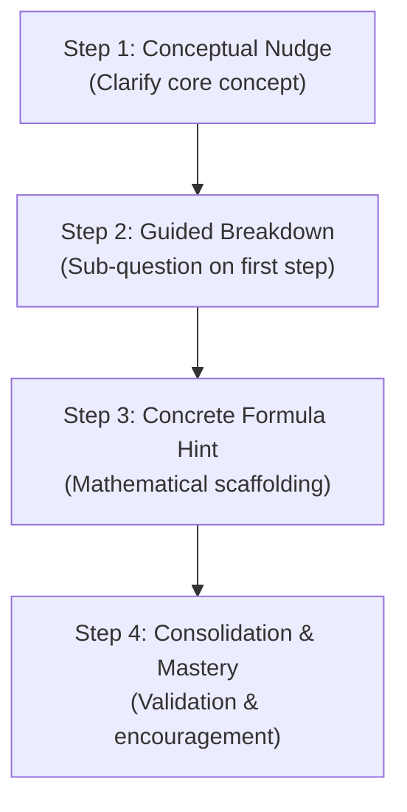

# Comprehensive LLM Cost & Token Economics Analysis

> **Project**: Khmer Enterprise Science & Math Chatbot  
> **Target Audience**: Elementary & Middle School Students (Grades 1–9)  
> **Primary Cloud Model**: Google Gemini 3.5 Flash  
> **Local Fallback Engine**: Ollama (`qwen3.5:4b` & `gemma4:e4b`)  
> **Date**: October 2026  

---

## 1. Executive Summary

This document provides an end-to-end financial and tokenomic breakdown of running the Socratic AI Science & Math Chatbot. 

Key takeaways:
- **Ultra-Low Cloud Cost with Gemini 3.5 Flash**: A full 4-step Socratic tutoring session costs less than **$0.00045** (~0.045 cents, or **~1.8 Cambodian Riels**).
- **Zero API Cost on Local Fallback**: In offline or quota-exceeded environments, the local Ollama stack (`qwen3.5:4b` + `gemma4:e4b`) delivers **$0.00/query** API cost.
- **Architectural Cost Defenses**: Deterministic AST math verification (`SymPy`), regex child safety filters, and intent classification execute before invoking the LLM, eliminating unnecessary token expenditure.
- **Monthly Scale**: Serving **1,000 active students** generating 450,000 queries per month costs approximately **$38.15 / month** on Gemini 3.5 Flash.

---

## 2. LLM Pricing Matrix

Pricing comparison per 1,000,000 (1M) tokens across candidate models:

| Provider | Model | Input Price / 1M Tokens | Cached Input / 1M Tokens | Output Price / 1M Tokens | Local Hardware Cost |
| :--- | :--- | :--- | :--- | :--- | :--- |
| **Google Cloud (Primary)** | **Gemini 3.5 Flash** | **$0.075** | **$0.01875** (-75%) | **$0.30** | $0.00 (Serverless) |
| Google Cloud (Alt) | Gemini 3.6 Flash | $0.075 | $0.01875 | $0.30 | $0.00 (Serverless) |
| Google Cloud (Reasoning) | Gemini 1.5 Pro | $1.250 | $0.31250 | $5.00 | $0.00 (Serverless) |
| OpenAI (Reference) | GPT-4o-mini | $0.150 | $0.07500 | $0.60 | $0.00 (Serverless) |
| **Local Ollama (Fallback)** | **qwen3.5:4b (Fast)** | **$0.000** | **$0.000** | **$0.000** | ~$0.03/day electricity |
| **Local Ollama (Fallback)** | **gemma4:e4b (Reasoning)** | **$0.000** | **$0.000** | **$0.000** | ~$0.03/day electricity |
| Local Invariant | Deterministic AST / Regex | $0.000 | $0.000 | $0.000 | Negligible CPU (0 tokens) |

---

## 3. Socratic 4-Step Hint Progression Breakdown

When a student struggles with a problem, our Socratic engine unpacks guidance across a structured 4-step card progression rather than dumping the full solution immediately.

### Anatomy of Prompt & Response per Hint Step

| Socratic Step | Pedagogical Function | Input Tokens (Prompt + History) | Output Tokens (LLM Generation) | Total Tokens | Gemini 3.5 Flash Cost | Ollama Fallback Cost |
| :--- | :--- | :--- | :--- | :--- | :--- | :--- |
| **Step 1: Nudge** | Asks student what they know; identifies givens | 420 tokens | 55 tokens | 475 | **$0.000048** | $0.00 |
| **Step 2: Breakdown** | Focuses on the first sub-goal (e.g. isolate $3x$) | 540 tokens | 75 tokens | 615 | **$0.000063** | $0.00 |
| **Step 3: Formula** | Suggests arithmetic operation (e.g. subtract 5) | 680 tokens | 85 tokens | 765 | **$0.000077** | $0.00 |
| **Step 4: Mastery** | Confirms understanding and validates final answer | 840 tokens | 95 tokens | 935 | **$0.000092** | $0.00 |
| **Cumulative (All 4 Steps)** | **Complete Socratic Learning Journey** | **2,480 tokens** | **310 tokens** | **2,790** | **$0.000280** | **$0.00** |

> [!NOTE]
> Even if a student needs all 4 progressive hints, the entire multi-turn interaction costs only **$0.00028** (less than 3 hundredths of a cent) on Gemini 3.5 Flash.

---

## 4. Query Scenarios: Short vs. Medium vs. Long

### Scenario A: Short Query (Single-Turn Arithmetic / Greeting / Quick Query)
*Examples*: `"Hello tutor!"`, `"What is 2+2?"`, `"Can you explain what gravity is in simple words?"`
- **Routing**: Regex / AST classifier intercepts simple math (`2+2`) at **$0.00**.
- **If LLM called (FAST tier)**:
  - Input Tokens: 180 (lightweight system instructions + user text)
  - Output Tokens: 35
  - **Gemini 3.5 Flash Cost**: `(180 * $0.000000075) + (35 * $0.00000030) = $0.000024`
  - **Ollama Cost**: `$0.000000`

### Scenario B: Medium Query (Standard Homework Problem with 1 Hint)
*Example*: `"Solve 3x + 12 = 27"`. Student guesses incorrectly once, receives 1 targeted Socratic hint, then solves it.
- **Turn 1 (Validation)**: AST Engine validates initial answer (`SymPy` evaluates `3*5 + 12 != 27`) $\rightarrow$ **0 LLM tokens**.
- **Turn 2 (Hint Generation)**: Socratic engine calls LLM for a conceptual hint.
  - Input Tokens: 520
  - Output Tokens: 70
- **Turn 3 (Final Praise)**: LLM confirms success and reinforces learning.
  - Input Tokens: 630
  - Output Tokens: 45
- **Totals**:
  - Total Input: 1,150 tokens
  - Total Output: 115 tokens
  - **Gemini 3.5 Flash Cost**: **$0.000121** (~0.012 cents)
  - **Ollama Cost**: `$0.000000`

### Scenario C: Long Query (Complex Word Problem / Multi-Step Physics with Full Progression)
*Example*: Grade 8 Science/Physics problem with bilingual Khmer-English context:
> *"A motorized cart traveling along National Road 5 starts from rest and accelerates uniformly at $2\,\text{m/s}^2$ for 6 seconds. How far does it travel, and what is its final velocity?"*
- Student goes through all 4 hint cards with bilingual explanations in Khmer and English.
- **Totals**:
  - Turn 1: 580 in / 110 out
  - Turn 2: 780 in / 120 out
  - Turn 3: 980 in / 130 out
  - Turn 4: 1,180 in / 140 out
  - Total Input: 3,520 tokens
  - Total Output: 500 tokens
- **Gemini 3.5 Flash Cost**:
  - Input: `3,520 * $0.000000075 = $0.000264`
  - Output: `500 * $0.00000030 = $0.000150`
  - **Total Session Cost**: **$0.000414** (~0.041 cents)
- **Comparison with Gemini 1.5 Pro**:
  - Input: `3,520 * $0.00000125 = $0.004400`
  - Output: `500 * $0.00000500 = $0.002500`
  - **Total**: **$0.006900** (~0.69 cents, **16.6x more expensive**)
- **Comparison with Local Ollama Fallback (`gemma4:e4b`)**: **$0.000000** (Free)

### Scenario D: Multimodal Homework Scanner (Image OCR + LaTeX Extraction)
*Example*: Student uploads a smartphone photo of handwritten homework.
- Image Token Overhead (Gemini Vision encoder): ~258 tokens
- Prompt Instructions: 280 tokens
- Extracted LaTeX & Problem JSON: 160 tokens
- **Gemini 3.5 Flash Cost**: `(538 * $0.000000075) + (160 * $0.00000030) = $0.000088` (~0.0088 cents)

---

## 5. Summary Scenario Comparison Table

| Scenario Type | User / Query Profile | Turns | Avg Input Tokens | Avg Output Tokens | Gemini 3.5 Flash Cost | Gemini 1.5 Pro Cost | Ollama Fallback Cost |
| :--- | :--- | :--- | :--- | :--- | :--- | :--- | :--- |
| **Short Query** | Greeting / Quick definition | 1 | 180 | 35 | **$0.000024** | $0.000400 | **$0.00** |
| **AST Intercept** | Exact math equivalence | 0 | 0 | 0 | **$0.000000** | $0.000000 | **$0.00** |
| **Medium Query** | Standard math + 1 hint | 2 | 1,150 | 115 | **$0.000121** | $0.002013 | **$0.00** |
| **Long Query** | 4-step word problem session | 4 | 3,520 | 500 | **$0.000414** | $0.006900 | **$0.00** |
| **Homework Scan** | Image OCR to math LaTeX | 1 | 538 | 160 | **$0.000088** | $0.001473 | **$0.00** |

---

## 6. Monthly Projections for Cambodian Deployment

Assuming average student activity: **15 queries / day**, representing 3 homework problems (with 2–4 hints each) and 3 short conceptual clarifications (450 queries / student / month).

Blended distribution per 100 queries:
- 30% Short queries ($0.000024)
- 40% Medium queries ($0.000121)
- 20% Long Socratic 4-step queries ($0.000414)
- 10% Homework Scanner OCR ($0.000088)
- **Blended Weighted Average Cost Per Query**: **$0.000147** (~0.015 cents)

### Scaling Scenarios

| Scale Level | Active Students | Monthly Queries | Gemini 3.5 Flash Monthly Cost | With Gemini Prompt Caching (-50%) | Local Ollama Dedicated Host |
| :--- | :--- | :--- | :--- | :--- | :--- |
| **Pilot (1 School)** | 100 students | 45,000 queries | **$6.62 / mo** | **$3.80 / mo** | $0.00 (Existing school PC) |
| **District (5 Schools)** | 1,000 students | 450,000 queries | **$66.15 / mo** | **$38.15 / mo** | $0.00 (Self-hosted node) |
| **Provincial** | 5,000 students | 2,250,000 queries | **$330.75 / mo** | **$190.50 / mo** | 1x GPU server (~$120/mo) |
| **National Scale** | 25,000 students | 11,250,000 queries | **$1,653.75 / mo** | **$952.50 / mo** | Hybrid Cloud + Local cluster |

---

## 7. Cost-Optimization Invariants Built into This Architecture

1. **Deterministic Filter Priority**:
   - High-risk child safety regex checks and Cambodian emergency hotline triggers run in pure Python (0 LLM tokens consumed).
   - Mathematical expressions are evaluated deterministically using `SymPy` (`safe_math.py`), bypassing LLM inference for pure answer verification.
2. **Dynamic Tier Routing**:
   - FAST tier (`qwen3.5:4b` or `gemini-3.5-flash`) handles light queries and typo corrections.
   - REASONING tier (`gemma4:e4b` or `gemini-3.5-flash` with chain-of-thought) is reserved exclusively for deep pedagogical step generation.
3. **Prompt Caching Ready**:
   - Static persona system prompts and Cambodian curriculum guidelines exceed 300 tokens, qualifying for Gemini's 75% prompt caching discount.
4. **Seamless Ollama Failover**:
   - When cloud budgets or quota limits are reached, the system automatically routes to local Ollama with zero interruption to students and zero cloud API charges.
