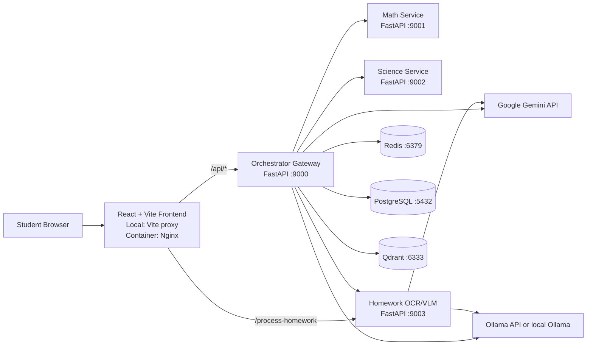

# Backend and Frontend Architecture

This document describes how the React frontend connects to the FastAPI backend and how the backend connects to its microservices, databases, and external AI providers.

## 1. High-Level Connection



## 2. Repository Structure

```text
Science_chatbot/
├── docker-compose.yml             # Root backend/infrastructure Compose file
├── backend-frontend-architecture.md
├── backend/
│   ├── orchestrator/              # Main API gateway and tutoring workflow
│   │   └── app/
│   │       ├── api/               # /api/query, session, step, upload routes
│   │       ├── core/              # Settings and logging
│   │       ├── infrastructure/    # HTTP clients, database, health checks
│   │       └── services/          # NLU, Socratic graph, LLM, OCR, guardrails
│   ├── services/
│   │   ├── math_service/          # Math solve/validation microservice (:9001)
│   │   └── science_service/       # Physics/Chemistry/Biology (:9002)
│   ├── homework_ocr_vlm/           # Worksheet image/PDF processing (:9003)
│   ├── ingestion/                 # Science reference data and Qdrant ingestion
│   └── testing/                   # Unit, integration, and interactive tests
└── frontend/
    ├── src/
    │   ├── App.tsx                # Main tabs, sessions, profile, scanner
    │   ├── components/            # Chat, scanner, stepper, profile UI
    │   ├── services/              # Backend API clients (chat and OCR)
    │   ├── data/                  # Demo problems and tutor data
    │   ├── utils/                 # Language and report helpers
    │   ├── types.ts               # Shared frontend TypeScript models
    │   └── main.tsx               # React entry point
    ├── vite.config.ts             # Local development API proxies
    ├── nginx.conf                 # Container-time /api reverse proxy
    ├── Dockerfile                 # Vite build, then Nginx serving
    └── package.json               # React/Vite dependencies and scripts
```

## 3. Frontend Responsibilities

| Area                | Main files                                    | Responsibility                                                               |
| ------------------- | --------------------------------------------- | ---------------------------------------------------------------------------- |
| Application state   | `frontend/src/App.tsx`                        | Profile, active tab, chat sessions, localStorage persistence                 |
| Chat UI             | `frontend/src/components/ChatView.tsx`        | Sends messages, navigates steps, submits step answers                        |
| Chat API client     | `frontend/src/services/geminiService.ts`      | Calls `/api/query`; formats the backend Socratic response                    |
| Homework scanner UI | `frontend/src/components/HomeworkScanner.tsx` | Selects an image/PDF and starts OCR processing                               |
| OCR API client      | `frontend/src/services/ocrService.ts`         | Calls OCR directly, then gateway fallback, then mock fallback                |
| Local proxy         | `frontend/vite.config.ts`                     | Sends `/api` to `localhost:9000` and `/process-homework` to `localhost:9003` |
| Production proxy    | `frontend/nginx.conf`                         | Sends `/api/` to the Docker service `orchestrator:9000`                      |

The browser does not need a backend API key. It sends requests to the backend and the backend owns the provider credentials.

## 4. Frontend-to-Backend API Connections

### Chat and Socratic workflow

1. `geminiService.ts` sends `POST /api/query` with:
   - `query`
   - `session_id`
   - `grade_level`
   - `language`
   - `system_prompt` is currently included by the frontend, but the backend request model currently ignores unknown fields.
2. The orchestrator normalizes the query, classifies intent, runs the Socratic graph, persists session state, and returns `step_widget` data.
3. The frontend renders the response and stepper widget.

### Step navigation

`ChatView.tsx` sends `POST /api/step/navigate` with `session_id` and a target index. The orchestrator restores the graph/session state, moves the active step, and returns the updated widget.

### Step answers

`ChatView.tsx` sends `POST /api/step/answer` with `session_id`, `step_number`, `student_answer`, and optional `is_correct`. The orchestrator updates the step status and session state.

### Homework OCR

`ocrService.ts` uses this order:

1. `POST /process-homework` through the Vite proxy directly to the OCR service (`:9003`).
2. If direct OCR fails, `POST /api/upload/ocr` through the orchestrator (`:9000`).
3. If that fails, `POST /api/upload/ocr?force_mock=true`.
4. If all network calls fail, the frontend uses its local mock worksheet data.

The orchestrator's `/api/upload/ocr` route normally forwards bytes to the OCR service through `HomeworkScannerClient`. It uses a deterministic mock response when `force_mock=true` or when the OCR service is unavailable.

## 5. Backend Structure and Responsibilities

### Orchestrator (`backend/orchestrator`)

The orchestrator is the public API gateway and owns the tutoring workflow.

- `app/main.py`: creates FastAPI, starts database/service registries, and mounts routers.
- `app/api/endpoints.py`: query, step navigation, step answers, and session routes.
- `app/api/upload.py`: OCR upload, mock worksheet, and exercise selection routes.
- `app/services/socratic/`: LangGraph tutoring state machine and stepper payloads.
- `app/services/nlu/`: normalization, intent classification, and subject routing.
- `app/services/llm/`: Gemini, Ollama, OpenAI-compatible, and mock provider adapters.
- `app/services/ocr/extractor.py`: calls the OCR microservice or returns a mock extraction.
- `app/services/session.py`: Redis-backed session state with local fallback behavior.
- `app/infrastructure/clients.py`: resilient HTTP clients with retries and circuit breakers.
- `app/infrastructure/database.py`: PostgreSQL session and telemetry persistence.
- `app/infrastructure/health_checks.py`: dependency and downstream service health checks.

### Math service (`backend/services/math_service`)

- `POST /solve`: validates and solves a mathematical expression.
- `POST /validate`: checks whether a student step is mathematically equivalent.
- `GET /health`: health status.

The orchestrator calls these endpoints through `MathServiceClient` at `MATH_SERVICE_URL`.

### Science service (`backend/services/science_service`)

- `POST /solve`: routes to Physics, Chemistry, or Biology solvers.
- `POST /validate`: validates a science concept/step.
- `GET /health`: health status.

The orchestrator calls these endpoints through `ScienceServiceClient` at `SCIENCE_SERVICE_URL`.

### Homework OCR/VLM (`backend/homework_ocr_vlm`)

- `POST /process-homework`: accepts an image/PDF and returns structured worksheet JSON.
- `GET /health`: service health.

The processor can use Gemini as its primary VLM and Ollama as its fallback provider.

## 6. Service URLs and Ports

| Component           |                    Local host URL |             Docker network URL | Used by                         |
| ------------------- | --------------------------------: | -----------------------------: | ------------------------------- |
| Frontend dev server |           `http://localhost:5173` |                            N/A | Browser                         |
| Frontend container  | `http://localhost:3000` if mapped |                            N/A | Browser                         |
| Orchestrator        |           `http://localhost:9000` |     `http://orchestrator:9000` | Frontend proxy, API clients     |
| Math service        |           `http://localhost:9001` |     `http://math-service:9001` | Orchestrator                    |
| Science service     |           `http://localhost:9002` |  `http://science-service:9002` | Orchestrator                    |
| Homework scanner    |           `http://localhost:9003` | `http://homework-scanner:9003` | Frontend or orchestrator        |
| Redis               |                  `localhost:6379` |                   `redis:6379` | Orchestrator                    |
| PostgreSQL          |                  `localhost:5432` |                      `db:5432` | Orchestrator                    |
| Qdrant              |                  `localhost:6333` |                  `qdrant:6333` | Ingestion/health/RAG components |

## 7. API Keys and Secrets

Only variable names and their purpose are listed here. Secret values must stay in local environment files or a secret manager and must never be committed or placed in frontend JavaScript.

| Variable                  | Backend consumer                                          | Purpose                               | Required                                      |
| ------------------------- | --------------------------------------------------------- | ------------------------------------- | --------------------------------------------- |
| `GEMINI_API_KEY`          | Orchestrator LLM providers, math/science solvers, OCR/VLM | Google Gemini text/vision access      | Required when Gemini is selected              |
| `OPENAI_API_KEY`          | Orchestrator OpenAI-compatible provider                   | Optional OpenAI-compatible LLM access | Optional                                      |
| `OLLAMA_API_KEY`          | OCR/VLM Ollama provider                                   | Remote Ollama authentication          | Required only for authenticated remote Ollama |
| `OLLAMA_FALLBACK_API_KEY` | OCR/VLM fallback provider                                 | Remote Ollama fallback authentication | Optional                                      |
| `DATABASE_URL`            | Orchestrator                                              | PostgreSQL connection string          | Required for persistent telemetry             |
| `POSTGRES_PASSWORD`       | Docker PostgreSQL                                         | Database container password           | Required by the database container            |

Related non-secret provider settings include `LLM_PRIMARY_PROVIDER`, `LLM_FALLBACK_PROVIDER`, `OLLAMA_BASE_URL`, `VLM_PROVIDER`, and `VLM_MODEL`.

### Important security note

The repository currently contains local `.env` files with values that look like live credentials, including under `backend/orchestrator/.env` and `backend/homework_ocr_vlm/.env`. Treat those credentials as exposed: rotate/revoke them, keep only placeholders in `.env.example`, and verify that `.env` files are ignored by Git. The frontend `.env.example` mentions `GEMINI_API_KEY`, but the current frontend request flow uses the backend gateway rather than sending that key from the browser.

## 8. Runtime Modes and Wiring Caveats

### Local development

Run the frontend with Vite. Its proxy sends:

```text
/api/*             -> http://localhost:9000
/process-homework  -> http://localhost:9003
/ocr/*             -> http://localhost:9003/*
```

### Container deployment

`frontend/Dockerfile` builds the React app and serves it with Nginx. `frontend/nginx.conf` proxies `/api/` to `http://orchestrator:9000/api/` on the Docker network.

The root `docker-compose.yml` currently defines the backend services and infrastructure, but does not define a `frontend` service. Therefore, `docker compose up --build` from the repository root does not start the frontend container unless it is added separately or the frontend is run with Vite. Also, the production Nginx configuration currently proxies `/api/` but does not define the direct `/process-homework` proxy used by the frontend OCR client; the gateway fallback remains available through `/api/upload/ocr`.

## 9. Typical Request Flows

### Chat question

```text
Browser
  -> Frontend fetch('/api/query')
  -> Orchestrator /api/query
  -> NLU + guardrails + Socratic graph
  -> Gemini or Ollama through the orchestrator LLM manager
  -> Redis session state and PostgreSQL telemetry
  -> Frontend renders solution and step_widget
```

### Domain solver request

```text
Orchestrator Socratic graph
  -> ResilientSolverAdapter
  -> Math service /solve or /validate
     OR Science service /solve or /validate
  -> Structured result returned to orchestrator
```

### Worksheet scan

```text
Browser upload
  -> OCR service /process-homework
  -> Gemini VLM or Ollama VLM
  -> Structured worksheet JSON
  -> Frontend selects an exercise
  -> Orchestrator /api/query starts the Socratic session
```

## 10. Useful Health Checks

```text
GET http://localhost:9000/health
GET http://localhost:9001/health
GET http://localhost:9002/health
GET http://localhost:9003/health
```

The orchestrator health routes also report downstream microservice, Redis, PostgreSQL, and Qdrant status.
