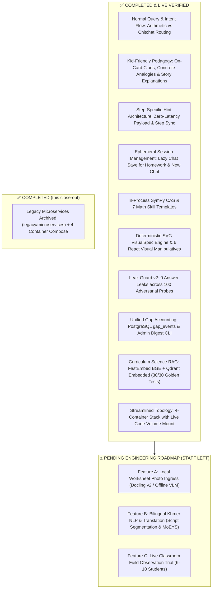

# ReanMore v2.1: Current Status & Pending Features Roadmap

> **Authoritative Architecture:** [`ReanMore_Architecture_v2.1.md`](ReanMore_Architecture_v2.1.md)  
> **Collaborator Guide:** [`plans/README.md`](plans/README.md)  
> **Target Release:** v2.1 (English-first MVP, 100% Offline Local Model, 4-Container Stack)  
> **Verification Status:** **651/651 backend tests + 50/50 golden worksheets + 100/100 adversarial probes (2026-10-30) ✅**

---

## 1. Executive Summary

ReanMore is an offline-first, $0.00 cloud inference Socratic STEM homework tutor for elementary students in Grades 1–6 (Mathematics & Science). 

Instead of dumping direct answers, ReanMore decomposes problems into 1–4 purposeful pedagogical milestones (one step for direct facts, 2–4 for strategy-driven problems), enforces 3-tier progressive hints paired with **deterministic SVG visual models** (Ten-Frames, Number Lines, Base-Ten Blocks, Array Grids, Fraction Bars, Bar Models), and strictly quarantines premature answers via **Leak Guard v2**.

This document summarizes **what has been completed and verified** and the roadmap for **what is left: classroom field testing plus two explicitly deferred features (OCR photo ingress, full Khmer NLP)**. The Khmer UI toggle and dynamic `/api/translate` ship in v2.1; Khmer segmentation/parser/MoEYS ingestion do not.

---

## 2. Status Matrix at a Glance



---

## 3. What We Have Built & Verified (Completed)

### 3.1 Normal Query Flow & Socratic Walkthroughs
* **NLU Chitchat & Persona Protection**: Greetings (`what ur name`, `hello`, `who are you`) route cleanly to friendly lion mascot persona greetings with **0 step cards**, eliminating ghost card bugs.
* **Arithmetic Problem Route Isolation**: Standalone math calculations (`15 + 27`, `8 * 6`, `100 - 45`) route directly to `INITIAL_SOLVE` rather than being hijacked as step attempts.
* **Pipeline Tracer Rewriter Guard**: Mathematical expressions with operators (`+`, `-`, `*`, `/`) are shielded from conversational query rewriting corruption.
* **Multi-Turn State Reset**: Submitting a new question or calculation cleanly clears previous problem states, resets stepper indices, and begins a fresh decomposition without duplicate requests.
* **Step Auto-Advancement**: Evaluates student inputs in real time (< 1ms deterministic check), presents celebration feedback, and auto-advances the student across all milestone steps until problem completion.
* **Docker Live Volume Mount**: Synchronized `- ./orchestrator/app:/app/app` in `docker-compose.yml`, allowing instant backend updates without slow container rebuilds.

### 3.2 Kid-Friendly Pedagogical Explanations & Scaffolding
* **Concrete Real-World Analogies**:
  * **Addition & Regrouping (`+`)**: Replaced dry math jargon (*"trade 10 ones for 1 ten rod"*) with intuitive elementary models: Single Blocks & Finger Counting 🧱🖐️, Cookie Bakery Boxes 🍪📦 (*"10 cookies fill 1 full box, extra cookies stay out on the plate!"*), and Ten-Towers 🗼.
  * **Subtraction & Regrouping (`-`)**: Replaced abstract borrowing rules with Unwrapping a Ten-Box 🎁 (*"We need to give blocks away, but our loose pile is too small! Let's unwrap 1 ten-box to get 10 fresh blocks to share!"*) and Crayon Box Sharing 🖍️.
  * **Multiplication (`×`)**: Team counting and Egg Cartons 🥚 (*"Skip count the rows: 3, 6, 9, 12!"*).
  * **Fractions (`/`)**: Equal Pizza Slicing 🍕 (*"2 slices out of a 4-slice pizza is the exact same amount of yummy pizza as 1 giant half-pizza slice!"*).
* **Direct On-Card `💡 Helpful Tip` Banner**: Rendered directly inside the Guiding Prompt box on both `StepChatBubble.tsx` and `StepCard.tsx`, giving elementary students immediate conceptual anchor clues without forcing them into nested modals.
* **Story-Driven "Explain Differently"**: Synthesizes rich, relatable everyday stories in `hintHelper.ts` rather than mechanically restating the problem mission.
* **States of Matter Science Scaffolding**: Structured 3-step concrete inquiry for Solids 🧊 (ice keeping its shape), Liquids 💧 (water flowing and splashing into cups), and Gases 🎈 (air filling floating balloons and steam from hot soup).

### 3.3 Dynamic Step-Specific Hint System & Zero-Latency Scaffolding
* **Step-Specific Hint Payloads**: Rule 9 in `planning.yml` and `templates.yml` requires each milestone step to generate its own 3 distinct hints (`hints[0]` guiding nudge, `hints[1]` visual scaffold, `hints[2]` micro-breakdown) tailored strictly to understanding that step's guiding question (`your_turn`).
* **Zero Additional LLM Calls**: All hints for all steps are pre-generated within the initial Socratic step widget payload. Clicking "Hint" triggers **0 network latency and 0 additional LLM inference calls**.
* **Step-Bound Inline Rendering**: Clicking "Hint" on the active step card reveals that step's hint in an inline yellow highlight banner (`Hint for Step X:`) directly under the guiding prompt, and auto-reveals on incorrect attempts to prompt thinking without revealing answers.
* **Navigation Synchronization**: Stepping forward/backward via `<` / `>` buttons or step dots immediately updates both the card hint and the modal `HintSheet` to the target step's specific hints, ensuring students never see hints from the wrong step.
* **Prompt Box Preservation**: Built cleanly without modifying or disrupting ReanMore's primary Guiding Prompt visual structure.

### 3.4 Ephemeral Session Management (Homework & New Chat)
* **Lazy Session Creation**: Clicking the "Homework" tab, the "New Chat" button, or "Ask ReanMore via Chat" navigates immediately to a fresh chat URL without pre-allocating an empty database record.
* **Zero Ghost Chats**: Sessions are only persisted to the database and history sidebar once the student actively sends their first message or uploads homework, keeping the chat history clean and clutter-free.

### 3.5 Core Symbolic & Observability Systems
* **In-Process SymPy CAS**: Symbolic arithmetic equivalence engine; LLM never performs raw math calculations.
* **Deterministic SVG VisualSpec Engine**: 6 pure React SVG visual components (`TenFrameSVG`, `NumberLineSVG`, `BaseTenBlocksSVG`, `ArrayGridSVG`, `FractionBarSVG`, `BarModelSVG`).
* **Leak Guard v2**: 6-token disclosure window, allowlist for given operands, and visual label scanner (0 leaks across 100 adversarial attack probes).
* **Unified Gap Accounting**: PostgreSQL `gap_events` table (Content, Learner, and System gaps) with automated weekly Monday morning Admin Audit Digest CLI.
* **Curriculum Science RAG**: Local FastEmbed ONNX runtime (`BAAI/bge-small-en-v1.5`) with embedded Qdrant vector store indexing 15 elementary science units (100% retrieval success across 30 golden curriculum questions).

---

## 4. Pending Features Roadmap (Staff Left to Do)

### Feature 1: Worksheet Photo Ingress & OCR Pipeline (Phase 4 — DEFERRED)
* **Status:** `DEFERRED — OUT OF THE v2.1 MVP`
* **Decision (2026-10-30):** The OCR stack is parked, not shipped. The `/api/upload/ocr`
  and `/api/upload/select` endpoints return `404` unless `ENABLE_API_OCR=true`, which
  defaults to `false`. OCR is not part of any MVP claim.
* **Why deferred:** the VLM path was both disabled and dependent on a cloud endpoint
  (`OLLAMA_BASE_URL=https://ollama.com`), which contradicts the offline/$0-inference
  MVP promise. Shipping it requires a local VLM, the BE-11 prompt-injection sanitizer,
  and a classroom handwriting stress test.
* **Prototype retained (not wired into the MVP UI):** camera/crop ingress,
  multi-exercise parsing, PII header masking, and graceful degradation. These are
  unit-tested but not reachable while the flag is off.
* **Re-entry criteria for Phase 4:** local VLM benchmark on classroom photos,
  sanitizer + adversarial stress results, and an explicit scope decision.

---

### Feature 2: Khmer UI Toggle + Translation (v2.1) & Full Khmer NLP (v2.2)
* **Shipped in v2.1:**
  * Header/profile language toggle (EN ↔ ខ្មែរ), persisted in the student profile.
  * Static bilingual UI strings render from each component's Khmer/English pairs.
  * Dynamic step content is translated through the existing `POST /api/translate`
    endpoint (`frontend/src/api/translateApi.ts` + `localizeStepsForKhmer`), with
    graceful fallback to English when the model is unavailable.
  * `ENABLE_KHMER_LANGUAGE` now defaults to `true`.
* **Explicitly deferred to v2.2 (out of MVP):**
  1. **Unspaced Khmer Script Segmentation & Tokenization** (`khmer-nltk` / CRF).
  2. **Parallel Socratic Prompt Set** authored natively in Khmer for all skills and hint tiers.
  3. **MoEYS Official Textbook Ingestion** into the local vector store.
  4. **Khmer Math Word Problem Parser** (entity/quantity extraction from Khmer stories).

---

### Feature 3: Physical Classroom Field Observation Trial
* **Status:** `READY FOR FIELD EXECUTION`
* **Current Foundation:**
  * 8-student testing protocol, parent/teacher consent templates, and teacher observation rubric complete in [`docs/pilot/`](../docs/pilot/).
  * 50 golden elementary math worksheets evaluation suite verified 100% green.
* **Remaining Work:**
  1. Coordinate with a Phnom Penh elementary school to run an in-person pilot session with 6–10 students in Grades 2–4.
  2. Collect qualitative field observations on hint comprehension, mascot engagement, and student independence.

---

### Feature 4: Legacy Microservice Pruning (Tech Debt Cleanup)
* **Status:** `COMPLETED (2026-10-30)`
* **What changed:**
  * `backend/services/math_service/` and `backend/services/science_service/` moved to
    [`legacy/microservices/`](../legacy/README.md) with their two dependent test files.
  * Stale root-level copies (`orchestrator/`, `testing/`, `services/`, `ingestion/`) and
    the old 7-service `docker-compose.legacy.yml` moved to `legacy/stray-root/`.
  * The active `backend/docker-compose.yml` is the 4-container stack; the compose
    qualification test now asserts exactly 4 services (Postgres, Ollama, Orchestrator,
    Frontend).
* **Verification:** full backend suite still green after the move (651 passed).

---

## 5. Verification Commands for Collaborators

```powershell
# From backend/
cd backend

# 1. Full backend suite (651 tests: unit + integration)
& .venv\Scripts\python.exe -m pytest -q

# 2. 50 Golden Math Worksheets Benchmark
& .venv\Scripts\python.exe testing\evaluation\golden_verifier.py

# 3. 100 Adversarial Leak Guard Probes
& .venv\Scripts\python.exe testing\evaluation\adversarial_evaluator.py

# 4. 30 Golden Science Curriculum RAG Benchmark
& .venv\Scripts\python.exe testing\evaluation\science_rag_evaluator.py

# 5. Pre-release qualification gate
& .venv\Scripts\python.exe testing\tools\run_release_gate.py

# From frontend/
cd ..\frontend
npm test        # vitest (19 tests)
npm run build   # production bundle
```
