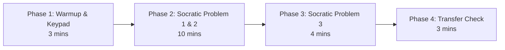

# Real-Kid Pilot Protocol & Teacher Observation Guide (ReanMore STEM Socratic Tutor)
> **Target Cohort:** 6–10 Elementary Students (Grades 1–6)  
> **Location:** Phnom Penh / Battambang School Partner Pilot Lab  
> **Session Length:** 20 Minutes / Student  
> **Architecture Reference:** Architecture v2.1 Section 15.3 & Socratic Pedagogy Invariants  
> **Zero-Mock & Zero-Cloud Invariant:** 100% On-Device Ollama (`qwen3.5:4b`), Local SymPy CAS, Deterministic SVG Visual Models  

---

## 1. Executive Summary & Objective

The primary objective of the **ReanMore Real-Kid Pilot** is to measure learning efficacy, student engagement, and system safety in an authentic learning environment without teacher intervention during tutoring turns.

### Primary Measured Outcomes:
1. **Zero Premature Leak Invariant:** 0 premature answer disclosures across all interactive turns, hint progressions, and SVG visual scaffolding.
2. **First-Turn Milestone Progress:** >70% of students complete at least 1 Socratic milestone without hitting maximum retry thresholds.
3. **Session Completion:** Students complete 3–5 targeted curriculum problems within the 20-minute session window.
4. **Learning Transfer Rate:** >80% comprehension retention measured via a parallel unassisted Transfer Problem immediately post-session.
5. **Usability & Tactile Confidence:** 100% self-directed input via the tactile on-screen Math Keypad without needing desktop keyboard shortcuts.

---

## 2. Cohort Design & Demographics

The pilot cohort consists of 8 students stratified across two primary cognitive tiers:

| Tier | Grade Levels | Student ID Range | Target Mathematical Skills | Primary Visual Model |
| :--- | :---: | :---: | :--- | :--- |
| **Primary Tier A** | Grades 1–3 | `STU-01` to `STU-04` | Add within 20, Subtract within 20, Add 2-digit regrouping, Sub 2-digit borrowing | Ten-Frame, Number Line, Base-Ten Blocks |
| **Primary Tier B** | Grades 4–6 | `STU-05` to `STU-08` | Multiplication tables (Array Grid), Equivalent Fractions, 1-Step Word Problems | Array Grid, Fraction Bar, Singapore Bar Model |

### Inclusion Criteria:
- Currently enrolled in Grades 1–6.
- Familiar with basic tablet / mouse touch interaction.
- Basic English familiarity (Grade 1–3: 10–14 word sentence comprehension; Grade 4–6: 15–20 word sentence comprehension).
- Signed parental consent and school participation authorization on file.

---

## 3. Ethics, Privacy & COPPA/GDPR-K Compliance

1. **Zero Cloud Inference:** All language generation runs on the local offline Ollama container (`qwen3.5:4b`). No kid prompt, dialogue, or keystroke ever leaves the school local network.
2. **Zero Student PII:** Student records are anonymized into opaque identifiers (`STU-01`, `STU-02`). No real names, school IDs, photos, or audio recordings are stored in databases or telemetry logs.
3. **Informed Consent & Assent:**
   - **Parental Consent Form:** Explains system purpose, local data handling, and right to withdraw at any time.
   - **Child Assent Script:** Simple 2-sentence kid-friendly assent before starting ("Today you get to try a fun math game robot. You can stop anytime you want. Are you ready to play?").
4. **Data Retention & Sanitization:** All session logs in the local PostgreSQL database are purged after the milestone evaluation audit.

---

## 4. 20-Minute Session Structure

Each student session follows an exact 4-phase protocol:



### Phase 1: Tactile Warmup & Keypad Orientation (Minutes 0–3)
- Student sits at the testing terminal.
- Observer shows the student how to tap numbers and symbols on the tactile Math Keypad.
- Student completes 1 trivial warmup check (e.g. `2 + 3`) to build tactile muscle memory.
- Observer reminds student: *"The robot is your friend. If you get stuck, tap 'Need a Clue?' to get a hint!"*

### Phase 2: Core Socratic Practice (Minutes 3–13)
- Problem 1: Primary grade-level skill (e.g., `8 + 5` for Grade 1; `15 + 27` for Grade 2; `2/4 = ?` for Grade 4).
- Problem 2: Next grade-level challenge problem.
- Student interacts via Socratic Milestones:
  - Reads Mission and Clue.
  - Views interactive SVG visual model (Ten-frame, Number line, Base-ten blocks, Fraction bar).
  - Types or taps candidate answers.
  - Progressive Hints Tier 1, 2, 3 triggered if needed.
- Observer records observation sheet (do not speak or help unless technical hardware freeze occurs).

### Phase 3: Challenge Problem (Minutes 13–17)
- Student attempts 1 word problem or higher-digit problem (e.g. `Sophea has 12 apples...` or `82 - 45`).
- System enforces 6-second watchdog and leak guard invariants.

### Phase 4: Post-Session Transfer Check (Minutes 17–20)
- The student is handed a physical paper index card with **1 Transfer Problem** that uses identical mathematical structures with distinct numbers.
- Student solves it with pencil/paper without AI guidance.
- Measures if student internalized the concept (e.g. regrouping across 10, trading tens, array rows) rather than just guessing.

---

## 5. Teacher Observation Rubric

Observers complete this rubric for each student session:

### Student Session Header:
- **Student Code:** `STU-___`
- **Grade:** `[ ] 1  [ ] 2  [ ] 3  [ ] 4  [ ] 5  [ ] 6`
- **Observer Name:** `____________________`
- **Start Time:** `____:____` | **End Time:** `____:____`

---

### Rubric Items:

| Metric | Level 1 (Struggling) | Level 2 (Developing) | Level 3 (Proficient) | Level 4 (Exemplary) | Score (1-4) |
| :--- | :--- | :--- | :--- | :--- | :---: |
| **1. Milestone Engagement** | Disengages or looks away after 1 incorrect attempt. | Needs verbal encouragement to tap hint button. | Reads clues and taps hints independently when stuck. | Enthusiastically works through all milestones with sustained focus. | `[ ]` |
| **2. Visual Model Utilization** | Ignores SVG model; guesses numbers at random. | Glances at model only when prompted by clue text. | Actively counts dots/blocks/slices on SVG model. | Explains answer referencing the visual model (e.g. "Because 1 ten became 10 ones"). | `[ ]` |
| **3. Socratic Independence** | Asks observer "What is the answer?" >=3 times. | Looks at observer for approval before submitting. | Submits answers independently; accepts retry feedback. | Completely self-guided; zero adult intervention required. | `[ ]` |
| **4. Tactile Keypad Ease** | Struggles to tap keys; mistypes numbers frequently. | Slow typing; pauses to find common operators (+, -). | Fluidly types single and double digit answers. | Effortlessly enters fractions or equations using keypad starters. | `[ ]` |
| **5. Concept Transfer Score** | Incorrect on paper transfer problem; no strategy shown. | Partial strategy shown on transfer card (e.g. started borrowing). | Correct transfer answer with minor arithmetic slip. | 100% correct transfer problem solved in <90 seconds with clear work. | `[ ]` |

---

## 6. Real-Time Telemetry & Gap Event Verification

During the pilot, the system runs with the Unified PostgreSQL Gap Ledger active. After all sessions conclude, run the admin audit digest CLI:

```bash
& .venv\Scripts\python.exe scripts/generate_admin_digest.py
```

### Target Benchmark Thresholds:
- `LEAK_BLOCKED`: 0 events (Tutor templates and LLM never emitted raw answer strings).
- `CIRCUIT_BREAKER_TRIGGERED`: 0 events (Watchdog <= 6.0s on all turns).
- `RETRY_EXHAUSTED`: <10% of total problem sessions.
- `STUDENT_GIVE_UP`: 0 occurrences.

---

## 7. Pilot Debrief & Iteration Sign-Off

Upon conclusion of the pilot cohort:
1. Compile the 8 Teacher Observation Rubrics into the Pilot Evaluation Digest (`docs/digests/pilot_evaluation_cohort1.md`).
2. Calculate the **Concept Transfer Success Rate** (Target >= 80%).
3. Verify zero leaks recorded in the telemetry database.
4. Obtain Teacher Sign-Off and qualify system for school-wide production rollout.
