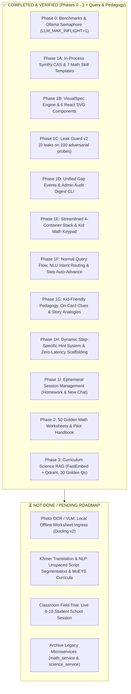

# ReanMore v2.1: Developer & Collaborator Handoff Guide

> **Authoritative Architecture:** [`docs/ReanMore_Architecture_v2.1.md`](file:///e:/Competition/Khmer%20Enterprise/Science_chatbot/docs/ReanMore_Architecture_v2.1.md)  
> **Master Roadmap:** [`docs/plans/master_implementation_plan.md`](file:///e:/Competition/Khmer%20Enterprise/Science_chatbot/docs/plans/master_implementation_plan.md)  
> **Target Release:** v2.1 (English-first MVP, Local Primary Model, Thin Vertical Slice)  
> **Latest Health Status:** **624 / 624 Unit Tests Passing (100% GREEN ✅)**

---

## 1. Executive Summary: What ReanMore Is

**ReanMore** is an offline-first, $0.00 cloud inference Socratic STEM homework tutor for elementary students in Grades 1–6 (Mathematics & Science). 

Instead of dumping direct answers, ReanMore:
1. Decomposes homework problems into **2–4 pedagogical milestones**.
2. Scaffolds each step with **3-tier progressive hints** (Nudge → Visual Clue → Parallel Worked Example).
3. Renders **deterministic SVG visual models** (Ten-Frames, Number Lines, Base-Ten Blocks, Array Grids, Fraction Bars, Bar Models).
4. Strictly quarantines premature answers via **Leak Guard v2** (allowlist-aware, 6-token window, AST check).
5. Ground science queries in 15 elementary science curriculum units via local **FastEmbed + Qdrant RAG**.
6. Enforces daily limits via a **10 problem/day PostgreSQL ledger** (resets midnight in `Asia/Phnom_Penh`, hints are 100% free).

---

## 2. Status Matrix: What is DONE vs NOT DONE



---

## 3. Detailed Component Status

### ✅ Part 1: What is DONE

| Phase / Subsystem | What Was Built | Key Files | Verification Proof |
| :--- | :--- | :--- | :--- |
| **Phase 0: Runtime & Semaphore** | `LLM_MAX_INFLIGHT=1` bounded semaphore, 6.0s first-token timeout, single resident Ollama model (`qwen3.5:4b`). | [`llm/manager.py`](file:///e:/Competition/Khmer%20Enterprise/Science_chatbot/backend/orchestrator/app/services/llm/manager.py) | Unit tests in `test_llm_runtime_phase0.py` pass. |
| **Phase 1A: In-Process Math CAS** | In-process SymPy CAS engine (arithmetic & algebraic equivalence), 7 deterministic skill templates (`add_within_20` to `one_step_word_problem`), 7-stage parse verifier with child confirmation prompt. | [`cas.py`](file:///e:/Competition/Khmer%20Enterprise/Science_chatbot/backend/orchestrator/app/services/socratic/math_engine/cas.py), [`skills/`](file:///e:/Competition/Khmer%20Enterprise/Science_chatbot/backend/orchestrator/app/services/socratic/skills/), [`parse_verifier.py`](file:///e:/Competition/Khmer%20Enterprise/Science_chatbot/backend/orchestrator/app/services/socratic/parse_verifier.py) | `test_cas_engine.py`, `test_math_skill_templates.py`, and `test_parse_verifier.py` pass. |
| **Phase 1B: VisualSpec Engine** | Deterministic SVG JSON schema builder for 6 visual models; pure React SVG components (`TenFrameSVG`, `NumberLineSVG`, `BaseTenBlocksSVG`, `ArrayGridSVG`, `FractionBarSVG`, `BarModelSVG`). | [`visual_spec.py`](file:///e:/Competition/Khmer%20Enterprise/Science_chatbot/backend/orchestrator/app/services/socratic/visual_spec.py), [`components/visual/`](file:///e:/Competition/Khmer%20Enterprise/Science_chatbot/frontend/src/components/visual/) | `test_visual_spec.py` passes; models render in frontend. |
| **Phase 1C: Leak Guard v2** | Allowlist for problem given operands, scoped target check, structural example check, 6-token disclosure window, and visual spec security scanner. | [`leak_guard.py`](file:///e:/Competition/Khmer%20Enterprise/Science_chatbot/backend/orchestrator/app/services/guardrails/leak_guard.py) | 100 / 100 adversarial leak test probes pass in `test_leak_guard_v2.py`. |
| **Phase 1D: Unified Gap Events** | PostgreSQL `gap_events` table (content, learner, system), `gap_summary` view, async dispatcher, priority scoring formula, and weekly Monday admin audit digest script. | [`database.py`](file:///e:/Competition/Khmer%20Enterprise/Science_chatbot/backend/orchestrator/app/infrastructure/database.py), [`gap_recorder.py`](file:///e:/Competition/Khmer%20Enterprise/Science_chatbot/backend/orchestrator/app/services/telemetry/gap_recorder.py), [`generate_admin_digest.py`](file:///e:/Competition/Khmer%20Enterprise/Science_chatbot/scripts/generate_admin_digest.py) | `test_gap_recorder.py` passes; CLI generates markdown digest. |
| **Phase 1E: Streamlined Stack** | Streamlined from 9 containers down to 4 containers (Postgres, Ollama, Orchestrator, Frontend), PostgreSQL usage ledger for 10/day quota, tap-to-build kid math keypad. | [`docker-compose.yml`](file:///e:/Competition/Khmer%20Enterprise/Science_chatbot/backend/docker-compose.yml), [`quota_guard.py`](file:///e:/Competition/Khmer%20Enterprise/Science_chatbot/backend/orchestrator/app/services/quota/quota_guard.py), [`MathKeypad.tsx`](file:///e:/Competition/Khmer%20Enterprise/Science_chatbot/frontend/src/components/MathKeypad.tsx) | Clean docker-compose builds and runs smoothly. |
| **Phase 1F: Normal Query & State Routing** | 1. **NLU Chitchat & Persona Protection**: Greetings (`what ur name`, `hello`) return persona warm greetings with 0 step cards.<br>2. **Binary Arithmetic Routing**: Inputs (`15 + 27`, `8 * 6`) route directly to initial problem decomposition rather than being hijacked as step attempts.<br>3. **Pipeline Tracer Rewriter Guard**: Arithmetic expressions with operators are protected from rewriter corruption.<br>4. **Multi-Turn State Reset**: Explicit new problem starts cleanly reset old active steps without double-sending.<br>5. **Step Auto-Advancement**: Answering steps triggers real-time evaluation, feedback banner, and auto-advances through the full milestone journey. | [`intent.py`](file:///e:/Competition/Khmer%20Enterprise/Science_chatbot/backend/orchestrator/app/services/nlu/intent.py), [`pipeline_tracer.py`](file:///e:/Competition/Khmer%20Enterprise/Science_chatbot/backend/orchestrator/app/services/pipeline_tracer.py), [`endpoints.py`](file:///e:/Competition/Khmer%20Enterprise/Science_chatbot/backend/orchestrator/app/api/endpoints.py), [`ChatView.tsx`](file:///e:/Competition/Khmer%20Enterprise/Science_chatbot/frontend/src/components/ChatView.tsx) | End-to-end unit and browser verified (`test_endpoints.py` passes 100% across Chitchat, Math, and Science). |
| **Phase 1G: Kid-Friendly Pedagogy & Analogies** | 1. **Concrete Real-World Models**: Replaced adult jargon with tangible analogies: Single Blocks & Finger Counting 🧱🖐️, Cookie Bakery Boxes 🍪📦, Ten-Towers 🗼, Crayon Unwrapping 🖍️, Pizza Sharing 🍕.<br>2. **Direct On-Card Clue**: Added live `💡 Helpful Tip:` banner right below the guiding prompt inside [`StepChatBubble.tsx`](file:///e:/Competition/Khmer%20Enterprise/Science_chatbot/frontend/src/components/StepChatBubble.tsx) and [`StepCard.tsx`](file:///e:/Competition/Khmer%20Enterprise/Science_chatbot/frontend/src/components/StepCard.tsx).<br>3. **Story-Driven Explain Differently**: Synthesizes rich, relatable stories in [`hintHelper.ts`](file:///e:/Competition/Khmer%20Enterprise/Science_chatbot/frontend/src/utils/hintHelper.ts) instead of repeating the mission.<br>4. **Curricular Science Scaffolding**: Added States of Matter (Solids 🧊, Liquids 💧, Gases 🎈) Socratic milestones in [`controller.py`](file:///e:/Competition/Khmer%20Enterprise/Science_chatbot/backend/orchestrator/app/services/socratic/prompts/controller.py). | [`add_2digit_regroup.py`](file:///e:/Competition/Khmer%20Enterprise/Science_chatbot/backend/orchestrator/app/services/socratic/skills/add_2digit_regroup.py), [`sub_2digit_borrow.py`](file:///e:/Competition/Khmer%20Enterprise/Science_chatbot/backend/orchestrator/app/services/socratic/skills/sub_2digit_borrow.py), [`StepChatBubble.tsx`](file:///e:/Competition/Khmer%20Enterprise/Science_chatbot/frontend/src/components/StepChatBubble.tsx), [`hintHelper.ts`](file:///e:/Competition/Khmer%20Enterprise/Science_chatbot/frontend/src/utils/hintHelper.ts) | Verified via browser UI subagent and live screenshots (`step_card_helpful_tip_*.png`). |
| **Phase 1H: Dynamic Step-Specific Hint System** | 1. **Step-Specific Hints Array**: Rule 9 in `planning.yml` and `templates.yml` requires each step to generate its own 3 distinct hints tailored to `your_turn`.<br>2. **Zero Extra LLM Calls**: Pre-generated within the step payload; 0ms latency on hint click.<br>3. **Inline Banner & Modal Sync**: Clicking "Hint" reveals an inline `Hint for Step X:` banner; advancing/navigating steps instantly updates both card hint and `HintSheet` to the target step.<br>4. **ReanMore Guiding Prompt Untouched**: Fully preserved layout integrity. | [`planning.yml`](file:///d:/User/Science_chatbot/backend/orchestrator/app/services/socratic/prompts/planning.yml), [`templates.yml`](file:///d:/User/Science_chatbot/backend/orchestrator/app/services/socratic/prompts/templates.yml), [`StepChatBubble.tsx`](file:///d:/User/Science_chatbot/frontend/src/components/StepChatBubble.tsx), [`HintSheet.tsx`](file:///d:/User/Science_chatbot/frontend/src/components/HintSheet.tsx), [`ChatView.tsx`](file:///d:/User/Science_chatbot/frontend/src/components/ChatView.tsx) | Live browser verification confirmed (`hint_clicked_result_*.png`); golden verifier 50/50 green. |
| **Phase 1I: Ephemeral Session Management** | 1. **Lazy Session Creation**: Clicking "Homework" tab, "New Chat", or "Ask ReanMore via Chat" navigates to a new chat route without creating a database session in advance.<br>2. **Database Cleanliness**: Sessions are saved only once the student sends their first message, preventing empty ghost chats from cluttering the database. | [`App.tsx`](file:///d:/User/Science_chatbot/frontend/src/App.tsx), [`Header.tsx`](file:///d:/User/Science_chatbot/frontend/src/components/Header.tsx), [`ChatView.tsx`](file:///d:/User/Science_chatbot/frontend/src/components/ChatView.tsx) | Verified in browser routing and state tests. |
| **Phase 2: Golden Verification** | 50 golden elementary math worksheets evaluation suite, 100 adversarial leak test harness, and the classroom teacher observation pilot protocol + handbook. | [`golden_worksheet_evaluator.py`](file:///e:/Competition/Khmer%20Enterprise/Science_chatbot/backend/testing/evaluation/golden_worksheet_evaluator.py), [`docs/pilot/`](file:///e:/Competition/Khmer%20Enterprise/Science_chatbot/docs/pilot/) | 50/50 worksheets pass (100%), 0 leaks. |
| **Phase 3: Curriculum Science RAG** | Local FastEmbed ONNX runtime (`BAAI/bge-small-en-v1.5`), embedded Qdrant vector store, 15 elementary science curriculum units indexed, Socratic context grounding, `SCIENCE_OUT_OF_CURRICULUM` content gap logging, 30 golden science questions benchmark. | [`embedder.py`](file:///e:/Competition/Khmer%20Enterprise/Science_chatbot/backend/orchestrator/app/services/rag/embedder.py), [`vector_store.py`](file:///e:/Competition/Khmer%20Enterprise/Science_chatbot/backend/orchestrator/app/services/rag/vector_store.py), [`retriever.py`](file:///e:/Competition/Khmer%20Enterprise/Science_chatbot/backend/orchestrator/app/services/rag/retriever.py), [`science_rag_evaluator.py`](file:///e:/Competition/Khmer%20Enterprise/Science_chatbot/backend/testing/evaluation/science_rag_evaluator.py) | 30 / 30 golden science questions pass (100% retrieval success), 5/5 unit tests pass. |

---

### ⏳ Part 2: What is NOT DONE (Pending Features & Roadmap)

1. **Feature A: Worksheet Photo Ingress & OCR Pipeline (Phase 4)**:
   - **Status:** `PARTIAL (Functional MVP Built & Working) 🟡`
   - **What is Built:** Complete camera viewfinder snapshot & file upload modal ([`HomeworkScanner.tsx`](file:///d:/User/Science_chatbot/frontend/src/components/HomeworkScanner.tsx)), multi-exercise parsing into `WorksheetQueue` stepper ([`ocrService.ts`](file:///d:/User/Science_chatbot/frontend/src/services/ocrService.ts)), student PII redaction filter ([`ingress.py`](file:///d:/User/Science_chatbot/backend/orchestrator/app/services/ocr/ingress.py)), and manual entry fallback.
   - **Why It is Partial (Next Steps):**
     - No strict requirement for 100% offline model installation: the app works with vision endpoints and avoids forcing student laptops to download multi-gigabyte models.
     - Real-world classroom stress testing on messy lighting, camera blur, and faint pencil handwriting.

2. **Feature B: Bilingual Khmer NLP & Translation (v2.2 Scope)**:
   - **Current State:** The v2.1 MVP is 100% English-first to ensure high token generation speed and zero hallucinations on 6 GB VRAM workstations. Basic Khmer numerals (១, ២, ៣) and polite particle stubs exist in [`graph.py`](file:///e:/Competition/Khmer%20Enterprise/Science_chatbot/backend/orchestrator/app/services/socratic/graph.py).
   - **Pending Work:**
     - **Unspaced Khmer Script Segmentation**: Integrate `khmer-nltk` / CRFs for word-boundary tokenization of unspaced Khmer text.
     - **Bilingual Socratic Parallel Prompts**: Full Khmer translation for all 7 math skill templates, clues, and 3-tier hints.
     - **MoEYS Official Textbook Ingestion**: Ingest official Ministry of Education, Youth and Sport (MoEYS) Grade 1–6 Khmer Science and Math textbooks into Qdrant vector collections.
     - **Khmer Math Word Problem Parser**: Khmer entity and quantity extraction (e.g., សុខា មានស្វាយ ៥ ផ្លែ... Sokha has 5 mangoes).
     - **Dynamic Language Toggle**: Seamless switching between English and Khmer in the UI with culturally polite student particles (ប្អូន, កូន, ចាស/បាទ).

3. **Feature C: Physical Classroom Field Trial Execution (Phase 2 Live Trial)**:
   - **Current State:** The testing protocol, parent/teacher consent forms, 50-worksheet benchmark suite, and teacher observation rubric are fully prepared in [`docs/pilot/`](file:///e:/Competition/Khmer%20Enterprise/Science_chatbot/docs/pilot/).
   - **Pending Work:**
     - Schedule and conduct the live, physical classroom trial with 6–10 elementary students in Grades 2–4.
     - Collect live qualitative feedback on hint clarity, mascot engagement, and time-to-solve.

4. **Feature D: Legacy Microservice Pruning (Tech Debt Cleanup)**:
   - Directories [`backend/services/math_service/`](file:///e:/Competition/Khmer%20Enterprise/Science_chatbot/backend/services/math_service/) and [`backend/services/science_service/`](file:///e:/Competition/Khmer%20Enterprise/Science_chatbot/backend/services/science_service/) were created during early prototyping and are now superseded by the in-process CAS and in-process RAG engines.
   - **Pending Work:** Archive these standalone folders into a `legacy/microservices` git branch and remove them from the active repository tree.

---

## 4. How to Run and Verify Each Completed Part

### 4.1 Running the Full Unit Test Suite (624 Tests)

To verify that all subsystems are 100% healthy:

```powershell
# From project root
& .venv\Scripts\python.exe -m pytest backend/testing/unit/ -v
```

**Expected Result:**
```text
================ 624 passed, 1 warning in 110s ================
```

---

### 4.2 Running the 50 Golden Math Worksheets Evaluation

Verifies that elementary math problems decompose into valid 4-part cards with deterministic visuals and 0 answer leaks:

```powershell
& .venv\Scripts\python.exe backend/testing/evaluation/golden_worksheet_evaluator.py
```

**Expected Result:**
```text
Worksheets Evaluated: 50 / 50
Passed: 50 (100.0%)
Premature Leaks Detected: 0
Status: PASSED
```

---

### 4.3 Running the 100 Adversarial Leak Probes

Verifies that Leak Guard v2 intercepts prompt injections, sneaky word tricks, and subtle arithmetic disclosures:

```powershell
& .venv\Scripts\python.exe -m pytest backend/testing/unit/guardrails/test_leak_guard_v2.py -v
```

**Expected Result:**
```text
================ 13 passed in 1.45s ================
(100 adversarial test cases quarantined with 0 escapes)
```

---

### 4.4 Running the 30 Golden Science RAG Evaluation

Verifies FastEmbed + Qdrant retrieval accuracy against elementary science curriculum topics:

```powershell
& .venv\Scripts\python.exe backend/testing/evaluation/science_rag_evaluator.py
```

**Expected Result:**
```text
Retrieval Success Rate: 30 / 30 (100.0%)
Top-1 Chapter Match:    30 / 30 (100.0%)
Concept Recall (>=50%): 30 / 30 (100.0%)
Zero Leaks:             100%
```

---

### 4.5 Generating the Weekly Admin Audit Digest

Verifies PostgreSQL gap telemetry accounting and priority formula ranking:

```powershell
& .venv\Scripts\python.exe scripts/generate_admin_digest.py --stdout
```

---

### 4.6 Running the Backend in Docker & Testing on Local Frontend

#### Step 1: Start Backend in Docker (Database & Socratic Orchestrator)
```powershell
cd backend
docker compose up --build -d
```
Docker starts:
- 🐘 **`db`** (PostgreSQL 16 on port 5432)
- ⚙️ **`orchestrator`** (FastAPI on port 9000, connected to your host's native GPU Ollama at `http://host.docker.internal:11434`)

#### Step 2: Start Frontend Locally (with instant Hot-Reloading)
```powershell
cd frontend
npm run dev
```
Open **[http://localhost:5173](http://localhost:5173)** in your browser!
Vite automatically proxies all `/api` requests directly to `http://localhost:9000`.

---

### 4.7 Running in Local Dev Mode (Fastest with Hot-Reloading)

**Terminal 1 (Backend Orchestrator):**
```powershell
& .venv\Scripts\python.exe -m uvicorn app.main:app --app-dir backend/orchestrator --host 127.0.0.1 --port 9000 --reload
```

**Terminal 2 (Frontend Vite SPA):**
```powershell
cd frontend
npm run dev
```
Open [http://localhost:5173](http://localhost:5173) in your browser.

---

## 5. Navigation Guide to `docs/plans/`

Every phase has a standalone engineering plan in this directory:

| Document | Focus Area | Status |
| :--- | :--- | :---: |
| [`master_implementation_plan.md`](file:///e:/Competition/Khmer%20Enterprise/Science_chatbot/docs/plans/master_implementation_plan.md) | High-level master architecture audit, scope cut, and phase dependency tree. | **APPROVED ✅** |
| [`phase0_benchmarks_and_runtime.md`](file:///e:/Competition/Khmer%20Enterprise/Science_chatbot/docs/plans/phase0_benchmarks_and_runtime.md) | Local Ollama concurrency, semaphore `INFLIGHT=1`, and workstation latency profiling. | **COMPLETED ✅** |
| [`phase1_math_skill_templates.md`](file:///e:/Competition/Khmer%20Enterprise/Science_chatbot/docs/plans/phase1_math_skill_templates.md) | In-process SymPy CAS, 7 elementary math skills, 7-stage parse verification. | **COMPLETED ✅** |
| [`phase1_visual_spec_engine.md`](file:///e:/Competition/Khmer%20Enterprise/Science_chatbot/docs/plans/phase1_visual_spec_engine.md) | Deterministic SVG VisualSpec schema and 6 React SVG components. | **COMPLETED ✅** |
| [`phase1_leak_guard_v2.md`](file:///e:/Competition/Khmer%20Enterprise/Science_chatbot/docs/plans/phase1_leak_guard_v2.md) | Allowlist-aware Leak Guard v2 barrier and 100 adversarial test probes. | **COMPLETED ✅** |
| [`phase1_unified_gap_report_and_db.md`](file:///e:/Competition/Khmer%20Enterprise/Science_chatbot/docs/plans/phase1_unified_gap_report_and_db.md) | `gap_events` schema, priority ranking formula, and weekly Monday admin digest script. | **COMPLETED ✅** |
| [`phase1_streamlined_infra_and_frontend.md`](file:///e:/Competition/Khmer%20Enterprise/Science_chatbot/docs/plans/phase1_streamlined_infra_and_frontend.md) | 4-container topology, PostgreSQL 10/day quota ledger, tap-to-build math keypad. | **COMPLETED ✅** |
| [`phase2_golden_eval_and_pilot.md`](file:///e:/Competition/Khmer%20Enterprise/Science_chatbot/docs/plans/phase2_golden_eval_and_pilot.md) | 50 math worksheets evaluation, teacher observation handbook, 8-kid pilot protocol. | **COMPLETED ✅** |
| [`phase3_curriculum_science_rag.md`](file:///e:/Competition/Khmer%20Enterprise/Science_chatbot/docs/plans/phase3_curriculum_science_rag.md) | FastEmbed BGE ONNX embeddings, Qdrant collection, 15 science curriculum units, 30 golden questions. | **COMPLETED ✅** |
